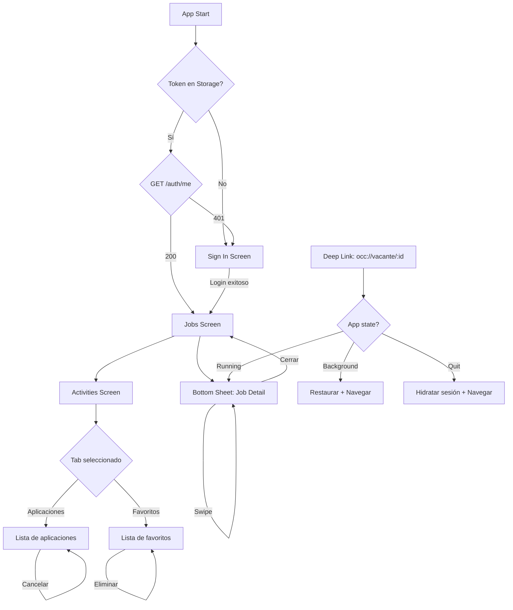

# A3 - Navegación y Deep Linking

## Estructura de Rutas con Expo Router

```
src/app/
├── _layout.tsx              # Root: providers, splash
├── sign-in.tsx              # Pantalla de login (pública)
└── (app)/                   # Grupo de rutas protegidas
    ├── _layout.tsx          # Guard de autenticación
    ├── index.tsx            # Job Search (home)
    └── activities.tsx       # Mis actividades
```

## Diagrama de Navegación



## Rutas Protegidas

### Implementación con Expo Router

El grupo `(app)` tiene un layout que verifica autenticación:

```typescript
// app/(app)/_layout.tsx
export default function AppLayout() {
  const { isAuthenticated, isHydrated } = useAuthStore();

  // Esperar hidratación de AsyncStorage
  if (!isHydrated) {
    return null; // Splash screen sigue visible
  }

  // Redirigir si no está autenticado
  if (!isAuthenticated) {
    return <Redirect href="/sign-in" />;
  }

  return <Stack>{/* screens */}</Stack>;
}
```

### Flujo de Protección

1. Usuario intenta acceder a `/` (Jobs)
2. `(app)/_layout.tsx` verifica `isAuthenticated`
3. Si `false` → `<Redirect href="/sign-in" />`
4. Si `true` → Renderiza el contenido

## Deep Linking

### Configuración del Scheme

```json
// app.json
{
  "expo": {
    "scheme": "occ",
    "android": {
      "intentFilters": [{
        "action": "VIEW",
        "data": [{
          "scheme": "occ",
          "host": "vacante",
          "pathPrefix": "/"
        }]
      }]
    }
  }
}
```

### URLs Soportados

| URL | Destino |
|-----|---------|
| `occ://vacante/123` | Bottom Sheet con vacante #123 |

### Manejo de Deep Link desde Notificación

```typescript
// Tres estados posibles:

// 1. FOREGROUND: App activa
notifee.onForegroundEvent(({ type, detail }) => {
  if (type === EventType.PRESS) {
    const jobId = detail.notification?.data?.jobId;
    Linking.openURL(`occ://vacante/${jobId}`);
  }
});

// 2. BACKGROUND: App en segundo plano
notifee.onBackgroundEvent(async ({ type, detail }) => {
  if (type === EventType.PRESS) {
    const jobId = detail.notification?.data?.jobId;
    Linking.openURL(`occ://vacante/${jobId}`);
  }
});

// 3. QUIT: App cerrada
const handleAppOpen = async () => {
  // Primero: hidratar sesión
  await waitForHydration();
  
  // Segundo: verificar notificación inicial
  const initial = await notifee.getInitialNotification();
  if (initial?.notification?.data?.jobId) {
    Linking.openURL(`occ://vacante/${initial.notification.data.jobId}`);
  }
};
```

## Coexistencia: BottomSheet + Router

### El Problema

El BottomSheet de @gorhom es un componente imperativo que existe fuera del árbol de navegación de Expo Router. Esto crea un desafío: ¿cómo sincronizar el estado del sheet con la navegación?

### La Solución

Usamos un store (Zustand) como fuente de verdad:

```typescript
// stores/jobs.store.ts
interface JobsState {
  selectedJob: Job | null;
  setSelectedJob: (job: Job) => void;
  clearSelectedJob: () => void;
}
```

### Flujo de Apertura

```
1. Usuario toca JobCard
   │
   ▼
2. setSelectedJob(job) en store
   │
   ▼
3. bottomSheetRef.current?.snapToIndex(0)
   │
   ▼
4. BottomSheet muestra JobDetailSheet
   │
   ▼
5. El contenido lee selectedJob del store
```

### Sincronización del Índice al Cerrar

Cuando el usuario cierra el sheet, el item activo debe seguir visible en la lista:

```typescript
const handleSheetClose = () => {
  clearSelectedJob();
  
  // FlashList mantiene el scroll position
  // No necesitamos scrollToIndex porque el item
  // ya estaba visible cuando se abrió el sheet
};
```

### Swipe y Sincronización

Durante el swipe entre vacantes dentro del sheet:

```typescript
const handleSwipeToJob = (direction: 'left' | 'right') => {
  const nextIndex = /* calcular */;
  
  // 1. Actualizar store
  setSelectedJob(jobs[nextIndex]);
  
  // 2. Actualizar referencia local para siguiente swipe
  currentJobIndexRef.current = nextIndex;
  
  // 3. NO scrolleamos la lista - el sheet está encima
  // 4. Al cerrar, la lista estará en posición correcta
  //    porque el nuevo job visible coincide con el índice
};
```

## Por Qué Expo Router sobre React Navigation

| Aspecto | Expo Router | React Navigation |
|---------|-------------|------------------|
| Configuración | File-based, mínima | Manual, archivos separados |
| Deep Linking | Automático por estructura | Configuración explícita |
| Protected Routes | Nativo (SDK 53+) | HOCs o custom logic |
| TypeScript | Inferencia de params | Tipos manuales |
| Debugging | URLs claros | Stack trace complejo |

Para este proyecto, Expo Router reduce significativamente el código de navegación y alinea la experiencia con el stack moderno de Expo.
